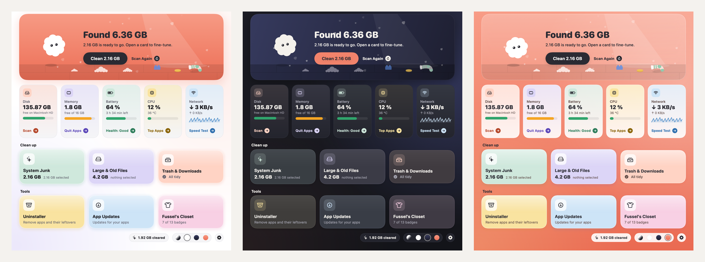

<p align="center">
  
</p>

<h1 align="center">Fussel</h1>

<p align="center">A small, friendly Mac cleaner. Fussel finds the fluff on your Mac and moves it to the Trash.<br><i>Currently in beta.</i></p>

<p align="center"></p>

- **System Junk**: app caches, logs and Xcode build data
- **Large & Old Files**: big files and things you haven't opened in ages
- **Uninstaller**: remove apps together with their support files, caches and preferences
- **Trash & Downloads**: empty the Trash and sweep out old downloads

Plus live tiles for disk space, memory, battery, CPU and network, three styles (White, Dark, Coral),
a playful tutorial, and a menu bar helper for a quick clean of caches and logs.

## Safety first

- Everything is moved to the Trash first, so you can always restore it.
- Only items that are already in the Trash are deleted permanently, and Fussel asks before doing it.
- Fussel never touches system files, Apple apps, or the top-level folders in your home folder.
- Nothing is selected in *Large & Old Files* or *Trash & Downloads* until you choose it.

## Install

1. Download **Fussel-Installer.pkg** from the latest [release](../../releases) and open it.
2. Fussel isn't signed with an Apple Developer ID yet, so macOS blocks the installer at first:
   open **System Settings › Privacy & Security** and click **Open Anyway**.
3. Click through the installer. Fussel lands in Applications and appears in the menu bar.
4. Optional but recommended: give Fussel **Full Disk Access** in
   **System Settings › Privacy & Security › Full Disk Access**.

Prefer drag and drop? Use **Fussel.dmg**, then run
`xattr -dr com.apple.quarantine /Applications/Fussel.app` once before the first launch.

Fussel lives in the menu bar: click the fluff to open or close it, right-click for more.
It starts with your Mac; turn that off in Settings.

Requires macOS 14 Sonoma or later. Runs natively on Apple Silicon and Intel.

## Build it yourself

```sh
scripts/build.sh 0.6.0      # builds dist/Fussel.app
scripts/package.sh 0.6.0    # builds dist/Fussel-Installer.pkg and dist/Fussel.dmg
```

Needs Xcode 15 or later (or the Swift toolchain that comes with it).

Every push to `main` is built by GitHub Actions. To publish a new release, bump the
number in `VERSION` (for example to `0.6.0`) and push: a beta release `v0.6.0` with
`Fussel.zip` attached is created automatically. If `release-notes/<version>.md` exists,
it becomes the release text; otherwise GitHub generates notes from the commits.

## Project layout

- `Sources/Fussel/`: the SwiftUI app
- `Resources/`: Info.plist and the app icon
- `design/`: icon artwork (light, dark, tinted) as SVG and PNG
- `scripts/`: build and packaging scripts
