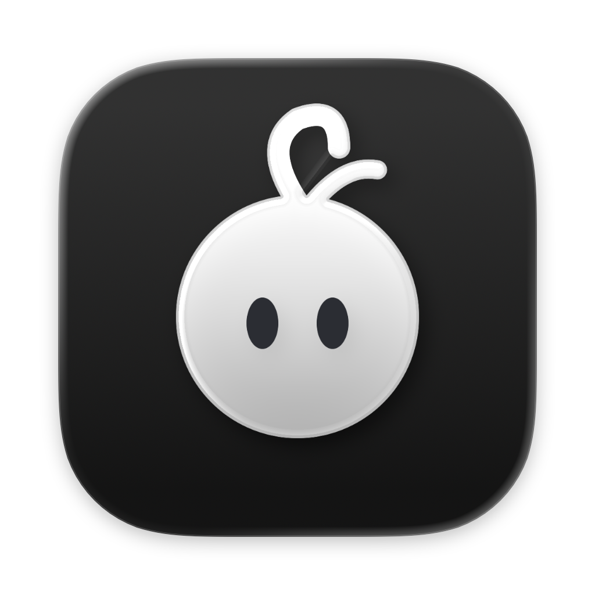
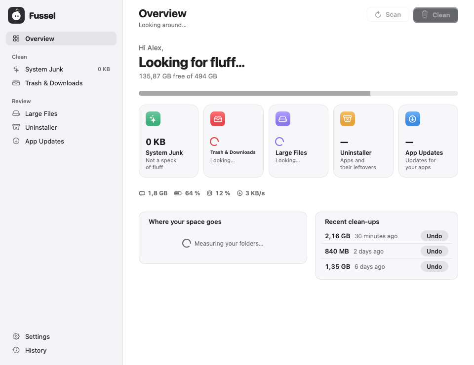
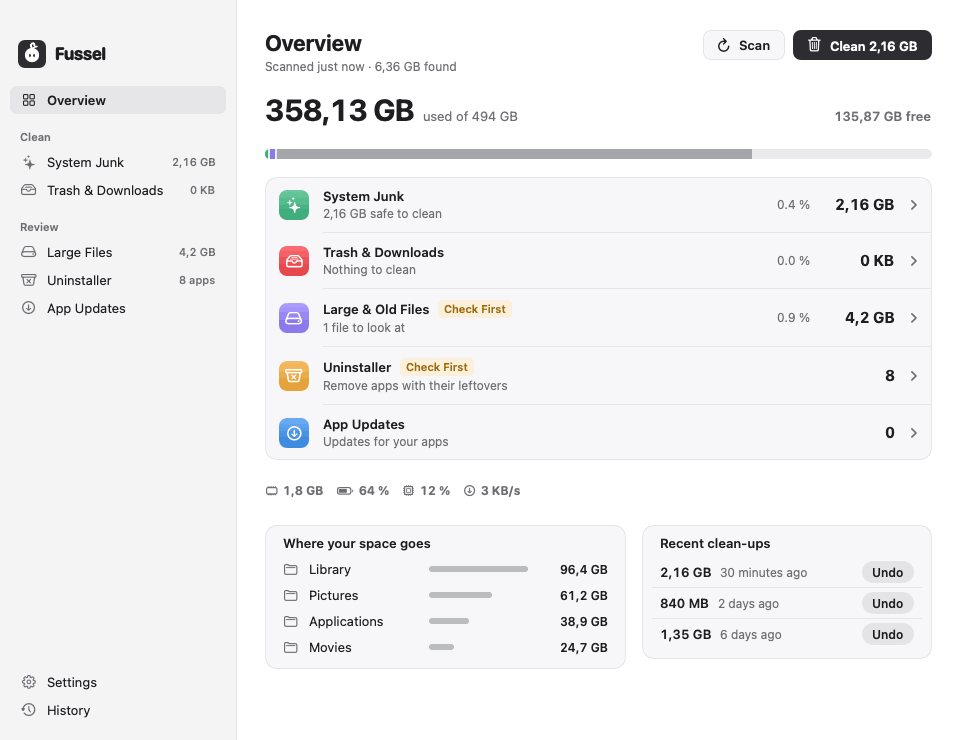
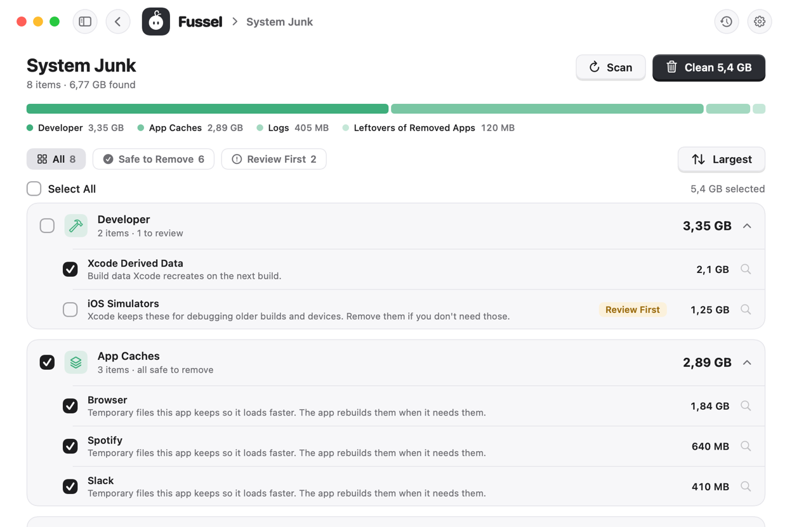
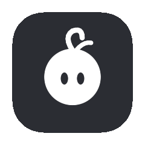

<p align="center">
  
</p>

<h1 align="center">Fussel</h1>

<p align="center">Less fluff, more Mac. Fussel finds caches, logs and forgotten files, tells you what each one is, and moves what you choose to the Trash.<br><a href="https://dshamil.github.io/fussel/">dshamil.github.io/fussel</a></p>

<p align="center"></p>

- **Overview**: used and free space, a row per tool, your biggest folders, and your last clean-ups with Undo
- **System Junk**: app caches, logs and Xcode build data
- **Trash & Downloads**: empty the Trash and sweep out old downloads
- **Large Files**: big files and things you haven't opened in ages
- **Uninstaller**: remove apps together with their support files, caches and preferences
- **App Updates**: updates for apps from the App Store and the web

Every item comes with a plain-language explanation and a **Safe to Remove** or **Review First** label.
Plus memory, CPU, battery and network at a glance, and a menu bar helper.

<p align="center"></p>

<p align="center">Light, Dark, Glass or Oreo, picked in Settings. Glass lets your desktop shine through, softly blurred; Oreo pairs a white sidebar with the dark main area.</p>

<p align="center"></p>

<p align="center"><br>
<i>Fussel lives in your menu bar and swings his curl while he looks around.</i></p>

## Safety first

- Everything is moved to the Trash first, so you can always restore it.
- Only items that are already in the Trash are deleted permanently, and Fussel asks before doing it.
- Fussel never touches system files, Apple apps, or the top-level folders in your home folder.
- Nothing is selected in *Large Files* or *Trash & Downloads* until you choose it.

## Privacy

Fussel works on your Mac and keeps what it finds to itself. There are no accounts, no analytics and no tracking. It only goes online for these:

- **Its own updates:** it asks GitHub whether a new Fussel is out (at most once a day, can be turned off in Settings) and downloads it when you choose to update.
- **Updates for your apps**, only when you check: it asks the App Store about App Store apps, and each other app's own update feed about that app.
- **The speed test**, only when you start it: macOS's built-in `networkQuality` tool measures your connection with Apple's servers.
- **Send Feedback** opens a GitHub form in your browser, filled in with Fussel's version, your macOS version and your Mac's chip. Nothing is sent until you submit it yourself.

Scan results, file lists and your clean-up history never leave your Mac.

## Install

1. Download **Fussel-Installer.zip** from the latest [release](../../releases). Your Mac unpacks it to **Fussel-Installer.pkg**; open that.
2. Fussel isn't signed with an Apple Developer ID yet, so macOS blocks the installer at first:
   open **System Settings › Privacy & Security** and click **Open Anyway**.
3. Click through the installer. Fussel lands in Applications and appears in the menu bar.
4. Optional but recommended: give Fussel **Full Disk Access** in
   **System Settings › Privacy & Security › Full Disk Access**.

Prefer drag and drop? Use **Fussel.dmg**, then run
`xattr -dr com.apple.quarantine /Applications/Fussel.app` once before the first launch.

Fussel lives in the menu bar: click the fluff to open or close it, right-click for more.
It starts with your Mac; turn that off in Settings.

Requires macOS 14 Sonoma or later. Runs natively on Apple Silicon and Intel.

## Build it yourself

```sh
scripts/build.sh 1.0.0      # builds dist/Fussel.app
scripts/package.sh 1.0.0    # builds dist/Fussel-Installer.pkg and dist/Fussel.dmg
```

Needs Xcode 15 or later (or the Swift toolchain that comes with it).

Every push to `main` is built by GitHub Actions. To publish a new release, bump the
number in `VERSION` (for example to `1.0.1`) and push: a release `v1.0.1` with the
installer, disk image and zip attached is created automatically. If `release-notes/<version>.md`
exists, it becomes the release text (a first line `<!-- title: … -->` sets the release title);
otherwise GitHub generates notes from the commits.

## Project layout

- `Sources/Fussel/`: the SwiftUI app
- `Resources/`: Info.plist and the app icon
- `design/`: icon artwork (light, dark, tinted) as SVG and PNG
- `scripts/`: build and packaging scripts

## Who makes Fussel

Fussel is made by **Dshamil Meziane** and built with [Claude](https://claude.com/claude-code). Every safety rule is covered by tests, and the code is open for anyone to check.

## License

MIT, see [LICENSE](LICENSE).
