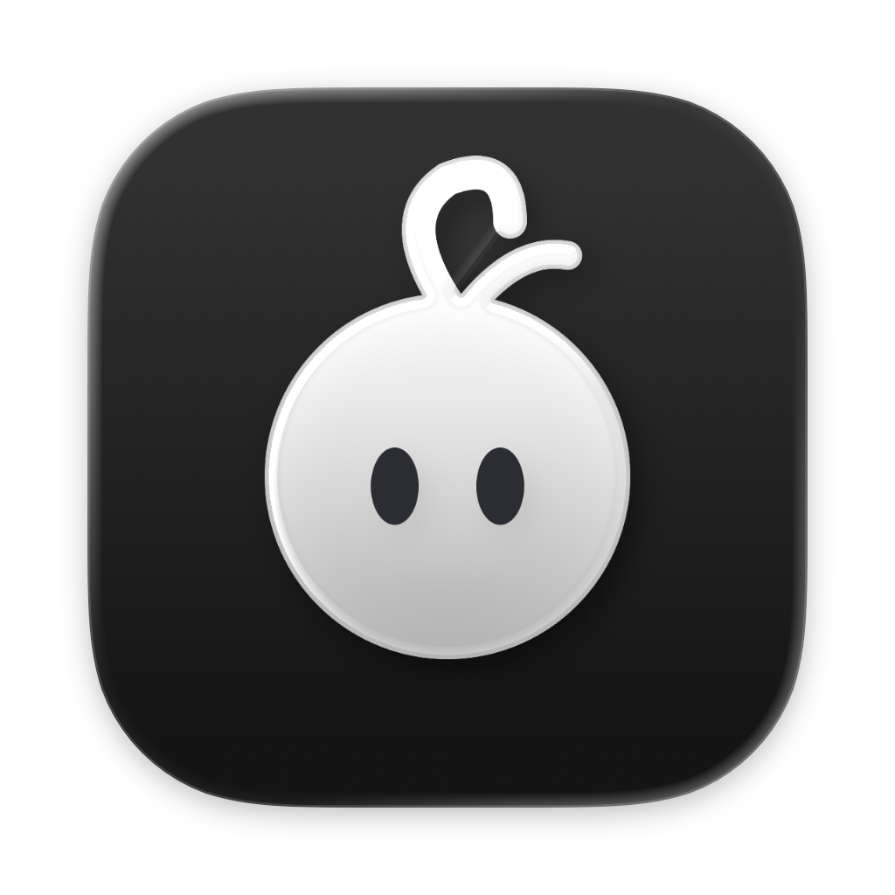
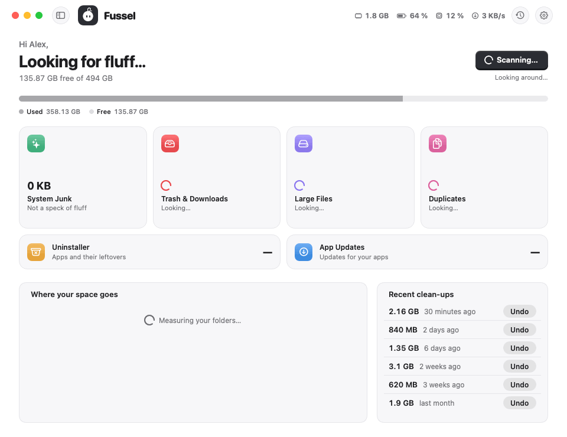

<!-- title: Fussel 1.1.10 · Room to breathe, nothing left empty -->
<p align="center">
  
</p>

<h1 align="center">Fussel 1.1.10</h1>

<p align="center"><b>Less fluff, more Mac.</b><br>A fuller overview that makes use of your whole window.</p>

<p align="center">
  
</p>

## What's new

- **The overview fills your window:** the tiles grow a little, and the cards at the bottom reach the edge of the window. "Where your space goes" and "Recent clean-ups" show as many rows as fit, however big the window is
- **Live values in the top bar:** memory, battery, CPU and network now sit up top, on every page. A click still opens the details
- **A legend for the storage bar:** every color now has a name and a size, plus what's left over and what's free. Point at a tool to light up its part of the bar, click to open it

New installs open a little taller, to make room. If you already use Fussel, your window keeps its size.

## Safety first

Everything Fussel cleans goes to the **Trash first**, and **Undo** puts it right back. Only items that are already in the Trash are deleted for good, and Fussel asks before doing that. System files, Apple apps and your main folders are never touched, and nothing marked *Review First* is ever picked for you. Nothing inside your Photos, Music or iMovie library is ever touched either. 32 automatic tests guard these rules on every build.

## Install

**Recommended: the installer**

1. Download **Fussel-Installer.zip** below. Your Mac unpacks it to **Fussel-Installer.pkg**; open that.
2. Fussel isn't signed with an Apple Developer ID yet, so macOS blocks it at first. Open **System Settings › Privacy & Security**, scroll down and click **Open Anyway** next to the Fussel installer.
3. Click through the installer. Fussel lands in your Applications folder and appears in the menu bar, next to the clock.
4. Recommended: allow **Full Disk Access** in System Settings › Privacy & Security, so Fussel can reach the Trash and every hidden cache.

Already using Fussel? On **0.9.8 or later**, just click **Update Now**. Older versions: install this one by hand once with the installer.

**Or: drag and drop**

Open **Fussel.dmg** and drag Fussel onto the Applications folder. Before the first launch, run this once in Terminal:
```
xattr -dr com.apple.quarantine /Applications/Fussel.app
```

Requires macOS 14 Sonoma or later. macOS 14 is no longer tested automatically, because GitHub retired its macOS 14 test machines; if something looks off there, please open an issue. Runs natively on Apple Silicon and Intel. The Glass cards need macOS 26; earlier versions get frosted glass.

## Good to know

- Undo works as long as the items are still in the Trash.
- Found something odd? **Send Feedback** in Fussel's menu opens a GitHub issue, already filled in with your Fussel and macOS version. Screenshots help a lot.

---

Made by **Dshamil Meziane**, built with Claude. Free and open source under the MIT license.
