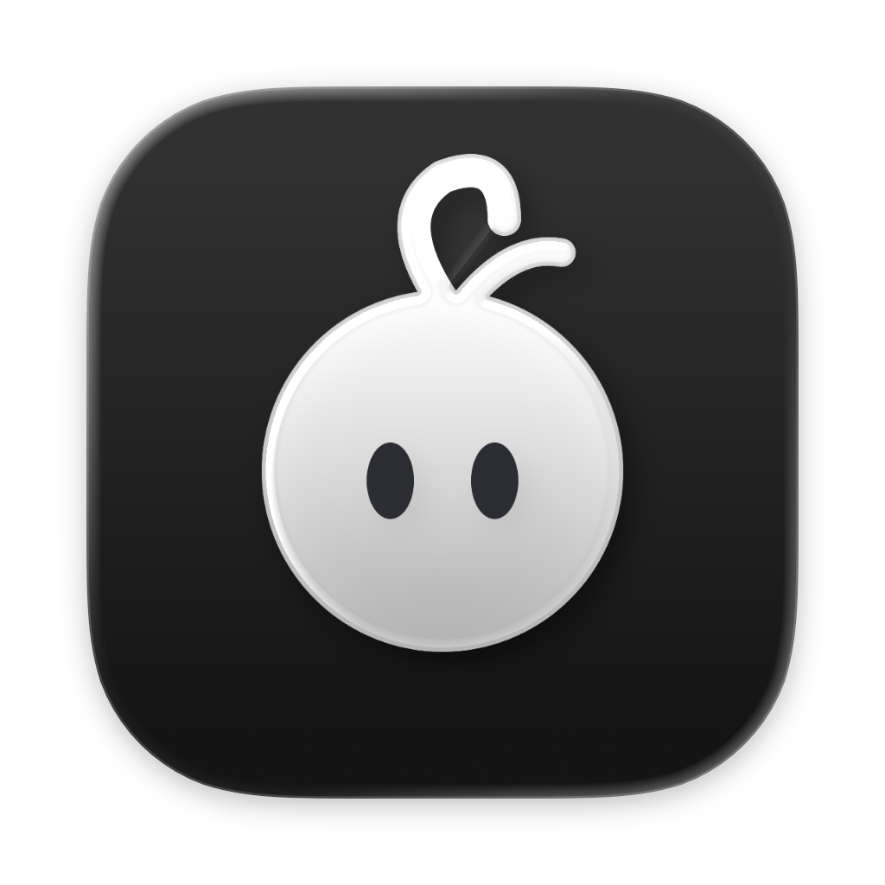
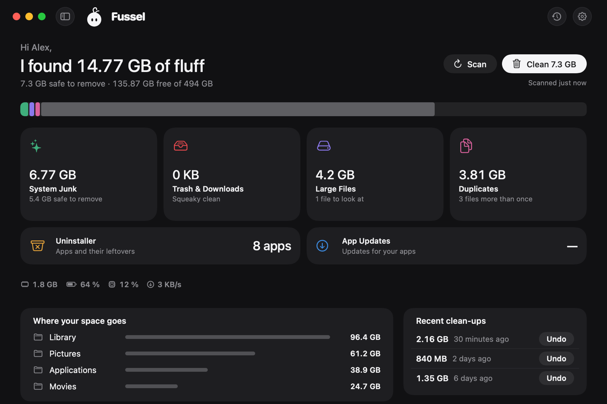

<!-- title: Fussel 1.1.9 · Pure -->
<p align="center">
  
</p>

<h1 align="center">Fussel 1.1.9</h1>

<p align="center"><b>Less fluff, more Mac.</b><br>A new, quieter style, and a Fussel who keeps an eye on things.</p>

<p align="center">
  
</p>

## What's new

- **Pure, a new style:** a quiet, minimal look with no outlines, flat pill buttons, lighter type and a chunky storage bar. Fussel appears on his own, like in the menu bar. Pick it under Settings › Style. It follows your Mac's light or dark mode
- **Fussel looks at you:** his eyes follow the pointer while it moves over the window, then settle after a moment
- **Drag apps onto the Uninstaller:** drop an app from the Finder to see what it left behind. Nothing is removed until you say so. Apple's apps and anything outside your Applications folders are politely refused
- **A storage bar that squeezes:** after a clean-up, the coloured parts close up in one smooth move. Files stay in the Trash until you empty it, so your free space grows at that point
- **A step player in the tour:** the current dot stretches into a bar that fills while the card is up. The middle cards move on by themselves, and pointing at a card or pressing pause holds it

All the motion stays still when Reduce Motion is on.

## Safety first

Everything Fussel cleans goes to the **Trash first**, and **Undo** puts it right back. Only items that are already in the Trash are deleted for good, and Fussel asks before doing that. System files, Apple apps and your main folders are never touched, and nothing marked *Review First* is ever picked for you. Nothing inside your Photos, Music or iMovie library is ever touched either. 32 automatic tests guard these rules on every build.

## Install

**Recommended: the installer**

1. Download **Fussel-Installer.zip** below. Your Mac unpacks it to **Fussel-Installer.pkg**; open that.
2. Fussel isn't signed with an Apple Developer ID yet, so macOS blocks it at first. Open **System Settings › Privacy & Security**, scroll down and click **Open Anyway** next to the Fussel installer.
3. Click through the installer. Fussel lands in your Applications folder and appears in the menu bar, next to the clock.
4. Recommended: allow **Full Disk Access** in System Settings › Privacy & Security, so Fussel can reach the Trash and every hidden cache.

Already using Fussel? On **0.9.8 or later**, just click **Update Now**. Older versions: install this one by hand once with the installer.

**Or: drag and drop**

Open **Fussel.dmg** and drag Fussel onto the Applications folder. Before the first launch, run this once in Terminal:
```
xattr -dr com.apple.quarantine /Applications/Fussel.app
```

Requires macOS 14 Sonoma or later. macOS 14 is no longer tested automatically, because GitHub retired its macOS 14 test machines; if something looks off there, please open an issue. Runs natively on Apple Silicon and Intel. The Glass cards need macOS 26; earlier versions get frosted glass.

## Good to know

- Undo works as long as the items are still in the Trash.
- Found something odd? **Send Feedback** in Fussel's menu opens a GitHub issue, already filled in with your Fussel and macOS version. Screenshots help a lot.

---

Made by **Dshamil Meziane**, built with Claude. Free and open source under the MIT license.
