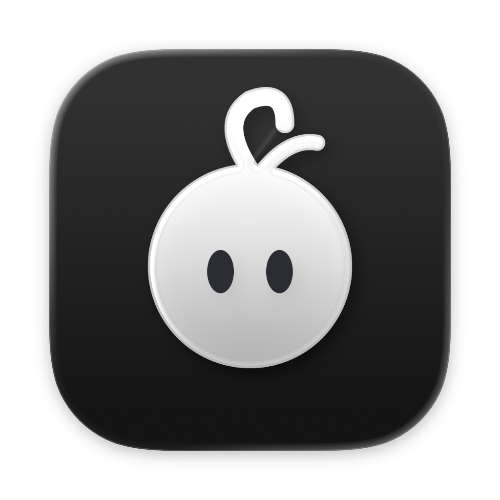
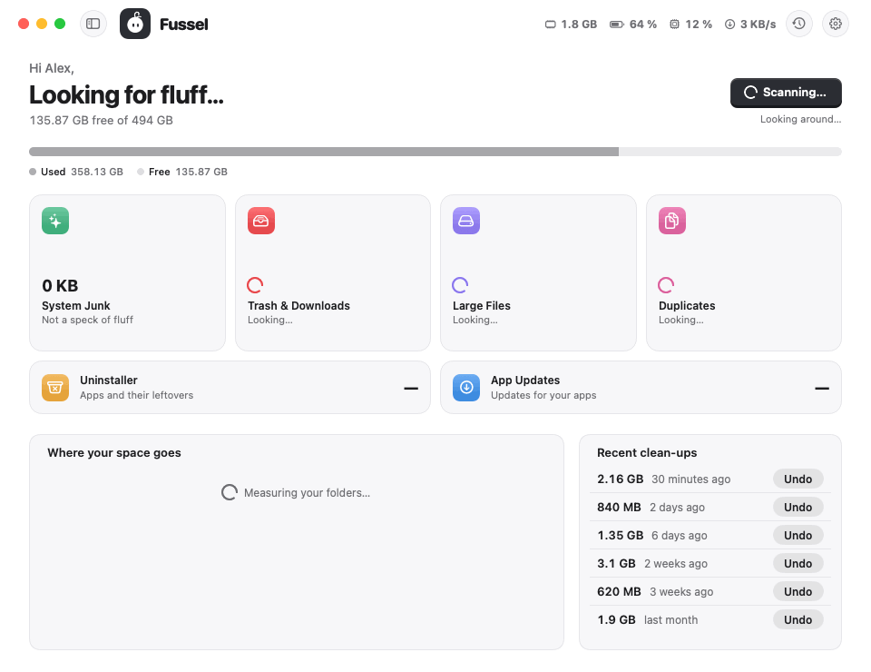

<!-- title: Fussel 1.2 · What grew? -->
<p align="center">
  
</p>

<h1 align="center">Fussel 1.2</h1>

<p align="center"><b>Less fluff, more Mac.</b><br>Find out what ate your disk, see how your Mac is holding up, and keep your folders off limits.</p>

<p align="center">
  
</p>

## What's new

- **What grew?** Fussel now remembers how big your folders are and shows what grew since about a week ago, like "Downloads +8.2 GB". It answers the question you actually have when your disk suddenly fills up. Give it a day or two to start: it needs an earlier measurement to compare with. Only folder names and sizes are kept, on your Mac
- **Mac Health:** a new card shows how much your battery still holds compared to new, its charge cycles, your disk's own self-check and when your Mac last restarted. The battery popover in the top bar shows the same, plus the trend over time. If your disk ever reports a problem, a warning appears at the top on every page
- **Leave Alone:** pick folders under Settings and Fussel skips them in every scan and never cleans anything in them

## Safety first

Everything Fussel cleans goes to the **Trash first**, and **Undo** puts it right back. Only items that are already in the Trash are deleted for good, and Fussel asks before doing that. System files, Apple apps and your main folders are never touched, and nothing marked *Review First* is ever picked for you. Nothing inside your Photos, Music or iMovie library is ever touched either. 32 automatic tests guard these rules on every build.

## Install

**Recommended: the installer**

1. Download **Fussel-Installer.zip** below. Your Mac unpacks it to **Fussel-Installer.pkg**; open that.
2. Fussel isn't signed with an Apple Developer ID yet, so macOS blocks it at first. Open **System Settings › Privacy & Security**, scroll down and click **Open Anyway** next to the Fussel installer.
3. Click through the installer. Fussel lands in your Applications folder and appears in the menu bar, next to the clock.
4. Recommended: allow **Full Disk Access** in System Settings › Privacy & Security, so Fussel can reach the Trash and every hidden cache.

Already using Fussel? On **0.9.8 or later**, just click **Update Now**. Older versions: install this one by hand once with the installer.

**Or: drag and drop**

Open **Fussel.dmg** and drag Fussel onto the Applications folder. Before the first launch, run this once in Terminal:
```
xattr -dr com.apple.quarantine /Applications/Fussel.app
```

Requires macOS 14 Sonoma or later. macOS 14 is no longer tested automatically, because GitHub retired its macOS 14 test machines; if something looks off there, please open an issue. Runs natively on Apple Silicon and Intel. The Glass cards need macOS 26; earlier versions get frosted glass.

## Good to know

- Undo works as long as the items are still in the Trash.
- Found something odd? **Send Feedback** in Fussel's menu opens a GitHub issue, already filled in with your Fussel and macOS version. Screenshots help a lot.

---

Made by **Dshamil Meziane**, built with Claude. Free and open source under the MIT license.
